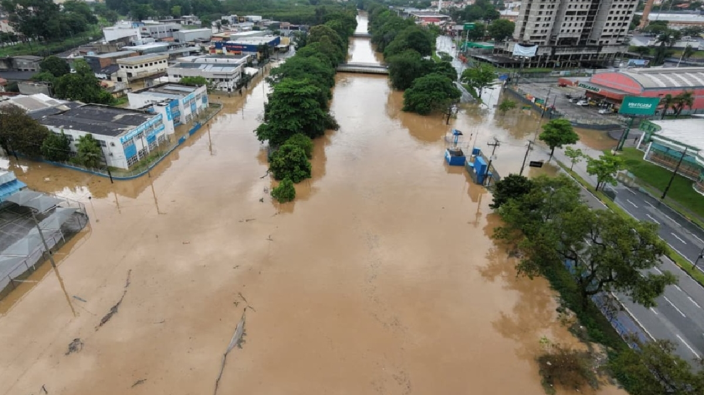
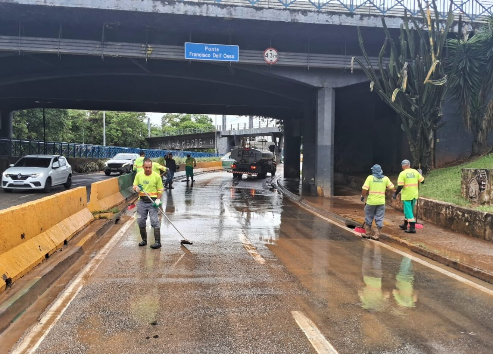

Quem mora em **Sorocaba** certamente não vai esquecer tão cedo o som deste último final de semana de novembro. Entre o sábado (7) e o domingo (8), o céu pareceu desabar sobre a nossa cidade: foram quase **96 milímetros de chuva acumulados** em pouquíssimas horas — praticamente 70% de toda a água esperada para o mês inteiro de novembro caindo de uma só vez.

Em pouco tempo, os grupos de mensagens começaram a apitar com vídeos impressionantes. O **Rio Sorocaba** subiu mais de dois metros acima do seu nível normal, tomou conta de trechos da **Avenida Dom Aguirre**, cobriu as imediações do **Parque das Águas**, da Praça Lions e da Avenida Quinze de Agosto, e levou a Prefeitura a decretar situação de emergência.

Enquanto nós, adultos, acompanhávamos os boletins da Defesa Civil preocupados com o trânsito, com o telhado de casa ou com parentes que moram em regiões mais baixas, havia alguém observando tudo aquilo em silêncio ao nosso lado: **os nossos filhos**.

Com o rostinho colado no vidro da janela ou espiando a tela do nosso celular, muitas crianças fizeram a mesma pergunta neste fim de semana: *"Pai, por que o rio invadiu a rua? A água vai chegar aqui em casa?"*

É exatamente nesse momento que nasce uma das conversas mais importantes da paternidade: **ensinar nossos filhos a compreenderem e respeitarem a imensa força da natureza**.

---

## O Meio-Termo do Pai: Nem Esconder a Realidade, Nem Espalhar o Pânico

Quando um temporal derruba dezenas de árvores pela cidade e transforma avenidas conhecidas das crianças em verdadeiras correntezas, a reação automática de muitos pais cai em um de dois extremos:

1. **Minimizar e fingir que nada aconteceu:** *"Não é nada, filho, vai brincar no quarto e não olha isso."*
2. **Transbordar ansiedade na frente dos pequenos:** assistir aos vídeos de carros ilhados repetidas vezes em voz alta, usando palavras de desespero que fazem a criança imaginar que a própria casa está prestes a ser levada pela água.

Como sempre defendemos no nosso guia sobre [limites e acolhimento na educação positiva](/blog/educacao-positiva-limites-com-amor/), crianças pequenas regulam as emoções delas pelo nosso tom de voz. Antes de entenderem quantos milímetros choveu em Sorocaba, elas leem a expressão no rosto do pai.

Falar sobre a **força da natureza** com os filhos não serve para assustá-los, mas para substituir o **medo irracional** pelo **respeito consciente**. O medo paralisa e gera pesadelos noturnos; o respeito ensina prudência, curiosidade científica e responsabilidade.

*Cheia do Rio Sorocaba na região da Avenida Dom Aguirre neste final de semana: imagens fortes que pedem diálogo calmo e educativo dentro de casa. (Foto: Divulgação / Redes Sociais)*

---

## "A Rua Invadiu o Rio ou o Rio Voltou para Casa?" — A Aula que Está na Janela

Para quem passeia de bicicleta com os filhos na ciclovia da Dom Aguirre ou leva as crianças para correr no Parque das Águas em dias de sol, ver aquele mesmo cenário debaixo d'água é chocante. Mas também é uma aula viva de geografia e meio ambiente que nenhum livro escolar consegue reproduzir sozinho.

Quando seu filho perguntar por que a água subiu tanto, experimente explicar de um jeito que faça sentido para a imaginação dele:

* **O rio tem uma "sala de visitas" natural:** Explique que o Rio Sorocaba não é apenas aquela faixa de água que vemos nos dias secos. Todo rio tem as suas margens baixas (a chamada várzea), que funcionam como uma esponja ou uma sala extra para quando chove muito. Quando construímos avenidas e cidades inteiras bem ao lado do rio e substituímos a terra por asfalto, a água da chuva perde onde infiltrar — e o rio simplesmente ocupa o espaço que sempre foi dele há milhares de anos.
* **A força da água e do vento não tem "botão de pausa":** Nossos filhos crescem cercados por telas onde tudo obedece a um clique (tema que já abordamos em [como proteger os filhos do excesso de telas](/blog/orkut-alerta-filhos-telas/)). Ver uma tempestade real mostra à criança que existem forças no planeta muito maiores do que nós. A natureza não faz isso por "maldade" ou porque está "brava"; ela segue leis físicas do clima, do relevo e do ciclo da água.

---

## Como Conversar sobre a Força da Natureza em Cada Idade

Cada faixa etária absorve um evento extremo como o temporal de Sorocaba de uma maneira diferente. Veja como conduzir o diálogo:

### 1. Dos 3 aos 6 anos: Segurança em primeiro lugar
Nessa fase, o pensamento da criança é literal. Se ela ouve que "Sorocaba está debaixo d'água", ela teme pelo próprio quarto, pelos brinquedos e pelo cachorro da família.
* **O que dizer:** *"Choveu muito forte hoje na nossa cidade e o rio ficou cheio demais, então algumas ruas lá perto dele ficaram alagadas. Mas aqui na nossa casa estamos seguros e protegidos, e os bombeiros estão cuidando de quem precisa de ajuda."*
* **O que evitar:** Deixar noticiários ou vídeos de resgates dramáticos rodando em looping perto da hora de dormir, pois isso afeta diretamente o [sono tranquilo e a ansiedade das crianças](/blog/orkut-ansiedade-sono-familia/).

### 2. Dos 7 aos 11 anos: Curiosidade, ciência e causa e efeito
Crianças em idade escolar querem entender o "como" e o "porquê". É a idade de ouro para despertar a consciência ambiental.
* **O que fazer:** Mostre no mapa de Sorocaba por onde o rio corta a cidade. Explique o que são **96 milímetros de chuva** (equivale a despejar quase 96 litros de água em cada metro quadrado do quintal!). Converse sobre como o lixo jogado na rua entope as bocas de lobo e impede a água de escoar.

### 3. A partir dos 12 anos: Cidadania e responsabilidade com o futuro
Com pré-adolescentes e adolescentes, a conversa ganha profundidade. Assim como falamos sobre [como ensinar cidadania aos filhos no dia a dia](/blog/eleicoes-2026-como-ensinar-cidadania-filhos/), os eventos climáticos extremos pedem reflexão sobre planejamento urbano, mudanças climáticas e preservação de áreas verdes.

*Domingo de reconstrução sob a Ponte Francisco Dell'Osso (Av. Dom Aguirre): mostrar às crianças o trabalho de quem limpa e reconstrói a cidade também faz parte da educação. (Foto: Secom / Prefeitura de Sorocaba)*

---

## Quando a Chuva Passa, a Lição Fica

Neste domingo, enquanto o nível do Rio Sorocaba começava a baixar e as equipes da Prefeitura e da Defesa Civil trabalhavam duro para retirar a lama das pontes e os galhos das avenidas, o sol voltou a aparecer tímido entre as nuvens.

As águas vão escoar, o trânsito na Dom Aguirre vai voltar ao normal e a rotina da semana vai recomeçar. Mas se você tirar **dez minutos hoje** para sentar com seu filho, olhar para o céu da nossa cidade e conversar sobre o poder da água, do vento e da terra, esse final de semana chuvoso terá deixado algo muito maior do que transtornos: terá formado um futuro adulto mais consciente, prudente e respeitoso com o planeta em que vive.

*(Quer ir além da conversa e ensinar regras práticas de proteção aos pequenos? Leia também nossa segunda postagem especial deste fim de semana: **[Depois do Temporal em Sorocaba: 5 Lições de Segurança e Empatia que Todo Pai Deve Ensinar aos Filhos](/blog/temporal-sorocaba-seguranca-empatia-licoes-forca-da-natureza-filhos/)**).*

---

### 👨‍👩‍👧‍👦 Mande Agora no Grupo da Família!

Você conhece algum pai, mãe, avô ou tio em Sorocaba (ou na região) que também passou o fim de semana impressionado com a chuva? 

Mais do que compartilhar apenas vídeos de alagamentos nos grupos de WhatsApp, **que tal compartilhar uma reflexão que ajuda a educar e acalmar as crianças da família?** 

👉 **Copie o link deste artigo e envie agora mesmo no grupo da sua família no WhatsApp!** Quando pais, avós e tios falam a mesma língua sobre respeito à natureza e segurança, nossas crianças crescem muito mais fortes e preparadas para a vida.
