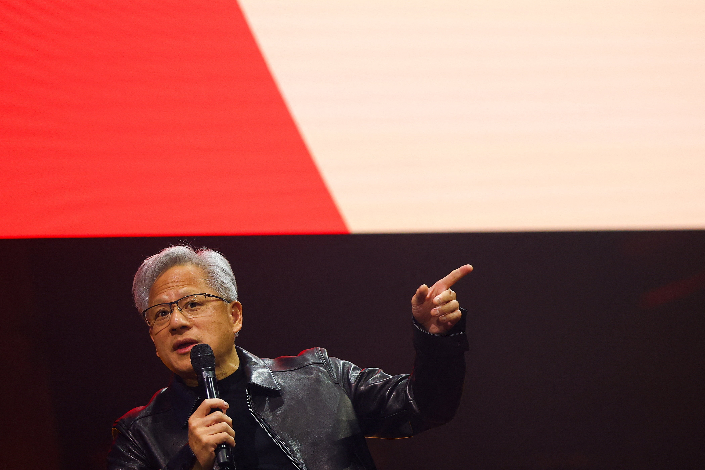

> **Resumo:** Uma disputa inesperada entre o executivo da maior fabricante de GPUs do planeta e uma alegada espionagem chinesa virou assunto de memes, mas também nos remete a reflexões sobre confiança, lealdade e, curiosamente, aos votos matrimoniais que homens e mulheres prometem ao se casar.

### 1. O que realmente aconteceu?

| Data | Evento | Fonte |
|------|--------|-------|
| **23/10/2026** | Publicação de reportagem no *Wall Street Journal* sobre a acusação de que a NVIDIA teria sido alvo de uma “espionagem industrial” liderada por uma suposta agente chinesa que tentou se infiltrar em reuniões estratégicas da empresa. | WSJ |
| **24/10/2026** | Jensen Huang respondeu em entrevista ao *CNBC*: “Se alguém quiser roubar tecnologia, terá que passar por dentro do nosso portão. Nós levamos a segurança a sério.” | CNBC |
| **26/10/2026** | A empresa divulgou, em seu blog oficial, que as investigações internas identificaram um “tentativa de acesso não autorizado” e que o incidente foi contido rapidamente. | Blog NVIDIA |

> **Nota:** Não existem provas de que a suposta agente tenha efetivamente obtido materiais confidenciais. O caso ainda está sob investigação de autoridades americanas e chinesas.

*Jensen Huang, fundador e CEO da NVIDIA, no centro das atenções após as investigações de segurança corporativa e geopolítica.*

---

### 2. Memes que dominaram a internet

| Meme | Descrição | Ideia para imagem (royalty‑free) |
|------|-----------|-----------------------------------|
| *“Jensen Huang, o Guardião da GPU”* | Foto do CEO com balão de fala: “Você não vai passar!” | Imagem do CEO em pose de “super‑herói” (p. ex. Unsplash “CEO portrait”) |
| *“When you think you’re a spy but the GPU says ‘nope’”* | Cena de filme de espionagem com um chip NVIDIA ao fundo. | Still de filme de espionagem + sobreposição de logo NVIDIA (Canva) |
| *“Casamento corporativo: ‘Prometo ser fiel ao código, à família e à RTX’”* | Troca de votos matrimoniais por termos de tecnologia. | Ilustração de um altar com placas de circuito. |

**Dica de busca:** use palavras‑chave como *“Jensen Huang meme”*, *“NVIDIA spy meme”* ou *“funny tech wedding”* em bancos de imagens gratuitos (Unsplash, Pexels) e depois adicione texto com o Canva.

---

### 3. Por que o caso traz à tona a importância dos **votos matrimoniais**?

1. **Confiança mútua** – Assim como um casal confia um no outro para cumprir promessas de fidelidade, uma empresa confia em seus funcionários e parceiros para proteger informações estratégicas.
2. **Compromisso de longo prazo** – O casamento envolve planejamento de futuro (filhos, finanças, projetos). Da mesma forma, a NVIDIA faz planejamentos de longo prazo (p. ex. IA, automóveis autônomos) que não podem ser comprometidos por vazamentos.
3. **Transparência** – Em um casamento saudável, as partes falam sobre problemas antes que eles se tornem crises. Jensen Huang fez exatamente isso ao comunicar publicamente o incidente, reforçando a confiança dos investidores (NVDA) e dos colaboradores.

> *“Casamento e negócios compartilham o mesmo ingrediente secreto: a honestidade.”* – Anônimo.

---

### 4. O que os investidores (NVDA) podem esperar?

| Aspecto | Impacto provável | Comentário |
|--------|------------------|-----------|
| **Preço das ações (NVDA)** | Pouca volatilidade a curto prazo; o caso já está precificado. | O mercado já descontou o risco, mas continue monitorando o volume de negociações. |
| **Desempenho de IA** | Nenhum efeito direto; a NVIDIA segue investindo pesado em AI e datacenters. | A empresa anunciou novos chips H100 II na mesma semana. |
| **Reputação** | Leve choque nas redes sociais, seguido de humor (memes). | A estratégia de comunicação transparente ajuda a proteger a marca. |

---

### 5. Conclusão

O “drama” entre Jensen Huang e a suposta agente chinesa demonstra como o mundo corporativo pode virar espetáculo de entretenimento online. No meio dos memes, fica claro que confiança – seja entre parceiros de casamento ou entre líderes e acionistas – continua sendo a base de qualquer relação duradoura.

**Hashtags para impulsionar o post:**

`#nvidia #alicehuang #ceonvidia #nvidiaações #ceonvidiajensenhuang #ceodanvidia #acoesnvidia #nvidaceojensenhuang #nvda #açõesnvidia`
