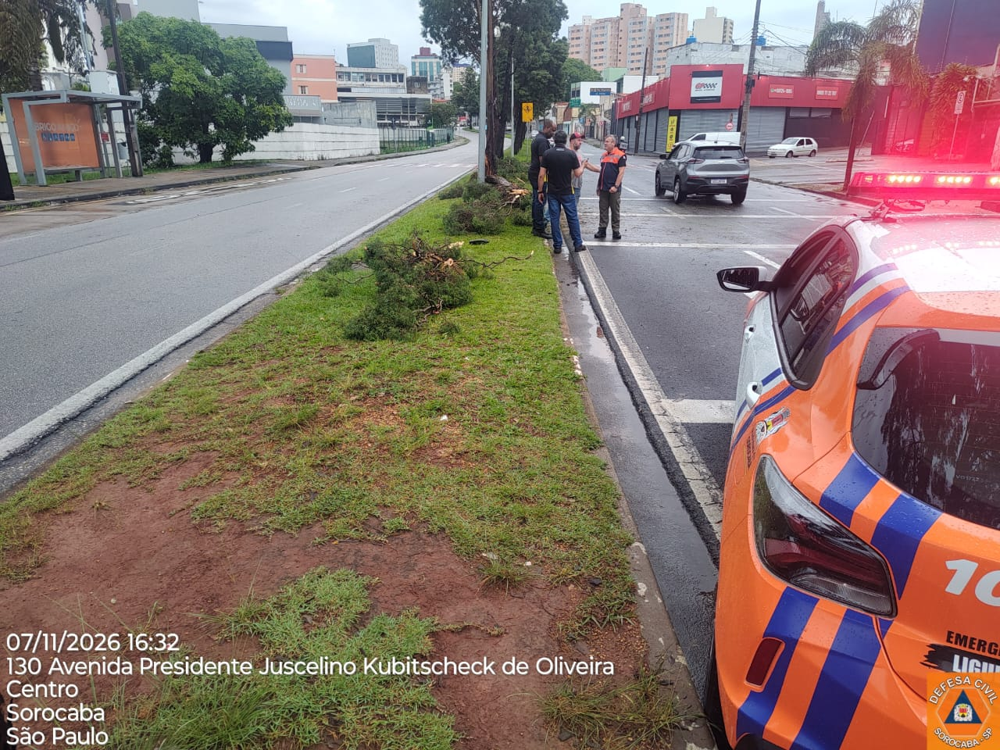
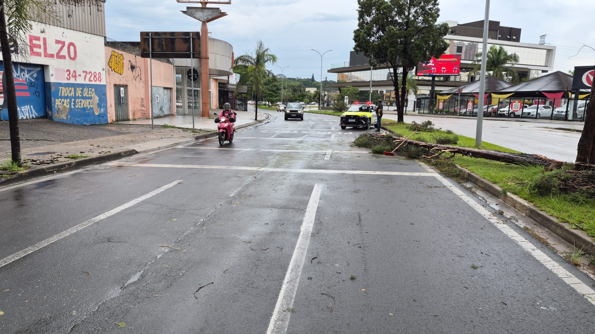

O domingo amanheceu diferente em **Sorocaba**. Depois de um sábado (7 de novembro) marcado por quase uma centena de milímetros de chuva acumulada, pelo transbordamento do Rio Sorocaba e pela decretação de **situação de emergência** no município, o cenário pelas ruas revelava o tamanho da força que passou por aqui.

Quem circulou pela cidade viu equipes da Defesa Civil e do Corpo de Bombeiros desobstruindo vias, dezenas de árvores de grande porte arrancadas pela raiz — inclusive em corredores movimentados como a Avenida Juscelino Kubitschek e a Avenida Quinze de Agosto —, muros danificados e relatos de motoristas que precisaram ser resgatados após ficarem ilhados na enxurrada.

Para nós, pais, ver um carro submerso ou uma árvore caída sobre o asfalto acende imediatamente um alerta protetor. Como conversamos no nosso primeiro artigo desta série sobre [como explicar a cheia do Rio Sorocaba e a força da natureza aos filhos sem gerar pânico](/blog/chuva-forte-sorocaba-como-explicar-forca-da-natureza-filhos/), o diálogo acolhedor é o primeiro passo.

Mas existe um **segundo passo igualmente urgente**: transformar o que vimos neste final de semana em **regras práticas de sobrevivência, prudência e empatia**. Afinal, nossos filhos não estarão para sempre no banco de trás do nosso carro; um dia eles voltarão sozinhos da escola, andarão de bicicleta pela cidade ou enfrentarão uma tempestade longe dos nossos olhos.

Será que eles saberiam o que fazer diante da fúria de um temporal?

---

## Por Que Ensinar sobre os Riscos da Natureza é um Ato de Amor Paterno

Muitas vezes protegemos tanto nossos filhos dentro de casa que esquecemos de treiná-los para ler os sinais do ambiente lá fora. Na infância da nossa geração (como relembramos em [nostalgia e tempo em família](/blog/nostalgia-orkut-tempo-em-familia/)), aprendíamos cedo a olhar para as nuvens carregadas no horizonte e correr para dentro antes do temporal cair.

Hoje, com fones de ouvido e olhos fixos no celular, muitos jovens não percebem a mudança do vento, o volume da enxurrada subindo na guia da calçada ou o risco de um galho prestes a ceder.

Ensinar seu filho a respeitar a **força da natureza na prática** significa dar a ele ferramentas reais para proteger a própria vida. Abaixo estão as **5 lições fundamentais** que o temporal deste fim de semana em Sorocaba nos convida a conversar à mesa de jantar.

*Atendimento da Defesa Civil na Av. Juscelino Kubitschek, no Centro de Sorocaba, na tarde de sábado (07/11/2026): a força do vento e da chuva encharca o solo e derruba até árvores antigas. (Foto: Defesa Civil / Prefeitura de Sorocaba)*

---

## 5 Lições Práticas que Todo Filho Precisa Aprender com o Pai

### 1. Nunca desafie a água em movimento (nem a pé, nem de carro)
Uma das cenas mais perigosas que se repetem em toda grande chuva em Sorocaba — seja na Dom Aguirre, no Parque Vitória Régia ou em baixadas de bairros — é a tentativa de atravessar pontos alagados achando que "dá para passar".
* **O que ensinar às crianças:** A água da enxurrada tem uma força invisível brutal. Apenas **15 centímetros de água corrente** (na altura da canela) já são suficientes para derrubar uma criança ou um adulto, e **30 a 45 centímetros** conseguem fazer um carro perder o contato dos pneus com o chão e ser arrastado.Além disso, a água barrenta esconde bueiros sem tampa e buracos no asfalto.
* **O exemplo no trânsito:** Se você estiver dirigindo com seus filhos sob chuva forte e vir uma rua alagada à frente, diga em voz alta: *"Filho, está vendo aquela água? Nunca vale a pena arriscar. Vamos dar a volta ou parar num lugar alto e esperar baixar."* Seu filho nunca esquecerá essa atitude de prudência.

### 2. Árvores, postes e grades não são abrigo durante tempestades
Neste final de semana, dezenas de árvores caíram em diferentes regiões de Sorocaba porque o solo encharcado perde a firmeza para segurar as raízes sob rajadas de vento.
* **O que ensinar:** Quando começar uma chuva forte com vento e raios, a regra número um é procurar um **abrigo de alvenaria fechado** (uma loja, a portaria de um prédio, a própria escola). Jamais se esconder debaixo de árvores, marquises frágeis ou perto de postes, placas metálicas e fios caídos no chão — que podem estar energizados na água.

*Queda de árvore em avenida de Sorocaba neste fim de semana: ensinar os filhos a identificarem riscos durante temporais é essencial para a autonomia segura deles. (Foto: Secom / Prefeitura de Sorocaba)*

### 3. O "Combinado da Família" para emergências climáticas
Crianças se sentem muito mais seguras quando sabem que existe um plano. Aproveite o assunto deste domingo para criar um protocolo simples com eles:
* Se começar um temporal na hora da saída da escola, a regra é **permanecer dentro da escola** até o pai ou a mãe chegar, mesmo que a gente atrase por causa do trânsito ou de vias interditadas.
* Ensine seus filhos a decorarem (e terem anotado na mochila) os números de emergência: **199 (Defesa Civil)** e **193 (Corpo de Bombeiros)**, além do telefone do pai e da mãe de cor.

### 4. Olhar para quem trabalha na chuva e para quem perdeu tudo (Empatia Real)
Quando a tempestade passa, começa o trabalho invisível de centenas de pais e mães de família: bombeiros, agentes da Defesa Civil, guardas municipais, eletricistas e garis que varrem toneladas de lama sob pontes como a Francisco Dell'Osso para que a cidade volte a funcionar na segunda-feira.
* **O que fazer com os filhos:** Ao passar por uma equipe trabalhando na limpeza da cidade, abaixe o vidro, agradeça e mostre ao seu filho o valor daquelas pessoas. E vá além: converse sobre as famílias que tiveram suas casas invadidas pela água. Que tal separar juntos brinquedos, roupas em bom estado ou alimentos para doar às campanhas do Fundo Social de Solidariedade? Empatia não se ensina com discurso, mas com gesto concreto.

### 5. A enchente da avenida começa no papel de bala da calçada
Por fim, conecte a força da natureza com a nossa responsabilidade diária. Quando o volume de chuva é extremo como os 96 mm deste fim de semana, até o sistema de drenagem mais limpo sofre. Mas quando garrafas plásticas, sacolas e entulhos são jogados nas ruas durante a semana, as galerias pluviais entopem nos primeiros dez minutos de chuva. Ensinar um filho a jamais jogar lixo no chão e a cuidar das árvores da própria calçada é plantar uma Sorocaba mais resiliente para os nossos netos.

---

## Um Pai Prevenido Cria Filhos Fortes para o Mundo

Não temos o poder de controlar as nuvens nem de impedir que grandes chuvas de verão ou de novembro caiam sobre Sorocaba. A natureza sempre terá a sua força, o seu ciclo e a sua grandeza.

O que está 100% nas nossas mãos — como destacamos desde os [primeiros passos do pai de primeira viagem](/blog/guia-pai-primeira-viagem/) até a formação cidadã dos nossos filhos — é usar cada acontecimento real da vida para preparar quem mais amamos.

Que este final de semana de muita água em Sorocaba não passe em branco dentro da sua casa. Chame seus filhos para perto hoje à noite, abrace-os, agradeça por estarem protegidos sob o mesmo teto e plante neles a sabedoria de quem admira a natureza, respeita a sua força e estende a mão ao próximo quando o temporal aperta.

---

### 📲 Compartilhe Essa Mensagem no Grupo da Sua Família!

Em dias de chuva forte como os que vivemos em Sorocaba neste final de semana, todo mundo manda fotos e alertas de trânsito no WhatsApp. **Mas pouca gente compartilha dicas que podem literalmente salvar vidas e orientar nossas crianças e adolescentes.**

Faça a diferença hoje: **envie este artigo agora mesmo no grupo da sua família!** 

> 💡 *Dica: basta copiar o link desta página e mandar para os avós, tios, primos e amigos com a mensagem: "Olhem que texto importante sobre a chuva deste fim de semana em Sorocaba e o que devemos conversar com as crianças em casa!"*
